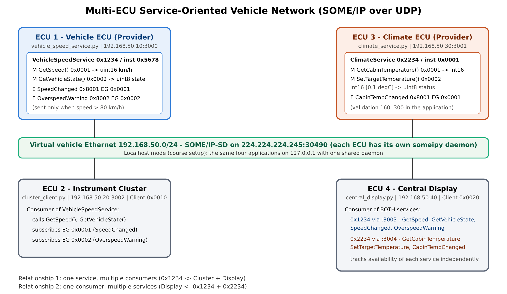

# Assignment 2 - Multi-ECU Service-Oriented Communication Using SOME/IP

Virtual vehicle service network in **Python + someipy**: four virtual ECUs communicating through two SOME/IP services, using methods, events, event groups, Service Discovery, request-response and publish-subscribe, with failure/recovery experiments and Wireshark analysis. Extends the Assignment 1 VehicleSpeedService.

| | |
|---|---|
| **Student** | Atharva Bobade |
| **Roll No. / Course** | 23310014 |
| **Report** | [`docs/Assignment2_Report.pdf`](docs/Assignment2_Report.pdf) |
| **Main capture** | [`captures/assignment2-multi-ecu.pcapng`](captures/assignment2-multi-ecu.pcapng) |



## Services

| Service | Provider | IDs | Methods | Events |
|---|---|---|---|---|
| VehicleSpeedService | Vehicle ECU | 0x1234 / 0x5678, v1, UDP | `GetSpeed()` 0x0001 → uint16 km/h<br>`GetVehicleState()` 0x0002 → uint8 (0 STOPPED, 1 MOVING) | `SpeedChanged` 0x8001, EG 0x0001<br>`OverspeedWarning` 0x8002, EG 0x0002 (speed > 80) |
| ClimateService | Climate ECU | 0x2234 / 0x0001, v1, UDP | `GetCabinTemperature()` 0x0001 → int16 (0.1 °C)<br>`SetTargetTemperature()` 0x0002 int16 → uint8 (0 ACCEPTED, 1 INVALID_TEMPERATURE, valid 160-300) | `CabinTemperatureChanged` 0x8001, EG 0x0001 |

Consumers: **Instrument Cluster** (VehicleSpeedService) and **Central Display** (both services).

## Repository structure

```
src/
├── vehicle_speed_interface.py   VehicleSpeedService definition (Assignment 1 + Task 11 additions)
├── vehicle_speed_service.py     ECU 1 Vehicle ECU            - provider   (Task 11)
├── cluster_client.py            ECU 2 Instrument Cluster ECU - consumer   (Task 12)
├── climate_interface.py         ClimateService definition                 (Task 13)
├── climate_service.py           ECU 3 Climate ECU            - provider   (Task 14)
├── central_display.py           ECU 4 Central Display ECU    - consumer of both (Task 15, runs Task 20 tests)
└── ecu_common.py                daemon connection, task-safe calls, graceful Ctrl+C/SIGTERM
scripts/
├── someipyd_ecu.py              someipy daemon launcher with 3 fixes for someipy 2.1.2 (see report 4.2)
├── vehicle_network_setup.sh     4 virtual ECUs (192.168.50.10/.20/.30/.40) on a virtual Ethernet bus
├── ecu.sh                       start one ECU (its daemon + app):  sudo scripts/ecu.sh vehicle|cluster|climate|display
├── run_full_scenario.sh         automated Tasks 16-22 incl. failure/recovery + capture
└── vehicle_network_teardown.sh
config/                          daemon configs (localhost + one per virtual ECU)
captures/
├── assignment2-multi-ecu.pcapng     main capture (1027 packets): SD, methods, events, failures
└── localhost-single-daemon.pcapng   course localhost setup (SD Offers + methods only)
wireshark_profile/               Decode-As + SOME/IP service/method/event name tables for Wireshark
screenshots/wireshark/           12 annotated Wireshark screenshots (Task 22)
screenshots/terminals/           4-terminal ECU output for Tasks 16-21
logs/run/, logs/localhost/       full output of every ECU and daemon
docs/                            Assignment2_Report.pdf (+ Markdown source, diagrams)
```

## Setup

```bash
sudo apt install python3-pip wireshark
pip install -r requirements.txt          # someipy 2.1.2
```

## Run - localhost mode (same environment as Assignment 1)

Five terminals:

```bash
python3 scripts/someipyd_ecu.py --config config/someipyd.json   # T0: someipy daemon
cd src
python3 cluster_client.py         # T1: Instrument Cluster ECU   (start consumers first - Task 17)
python3 central_display.py        # T2: Central Display ECU
python3 vehicle_speed_service.py  # T3: Vehicle ECU
python3 climate_service.py        # T4: Climate ECU
```

Wireshark on **Loopback: lo** shows the SD Offers and all method requests/responses. With **one shared daemon**, someipy delivers events and subscriptions to local apps internally, so they do **not** appear in Wireshark. Use the mode below to see them.

## Run - virtual vehicle network (one daemon per ECU; everything visible in Wireshark)

```bash
sudo scripts/vehicle_network_setup.sh
sudo ip netns exec vbus wireshark -i br0 &     # capture the vehicle bus
sudo scripts/ecu.sh cluster      # terminal 1
sudo scripts/ecu.sh display      # terminal 2
sudo scripts/ecu.sh vehicle      # terminal 3
sudo scripts/ecu.sh climate      # terminal 4
# Ctrl+C an ECU to stop it (StopOffer), run its command again to restart it (Task 21)
sudo scripts/vehicle_network_teardown.sh
```

Or run everything automatically: `sudo scripts/run_full_scenario.sh`.

**Wireshark setup:** copy `wireshark_profile/*` into `~/.config/wireshark/` (or use *Analyze → Decode As*: UDP 30490, 3000-3004 → SOME/IP). Useful filters:

- `someipsd`
- `someip.serviceid==0x1234 && someip.methodid==0x8002`
- `someip.methodid==0x8001` (shows that both services use Event ID 0x8001)

## Results

| Task | Result |
|---|---|
| 17 Service Discovery | Consumers wait; VehicleSpeedService appears at 23:28:25, ClimateService 12 s later, independently |
| 18 Multiple consumers | Vehicle ECU served GetSpeed/GetVehicleState to Client 0x0010 and 0x0020; 47 SpeedChanged + 9 OverspeedWarning delivered to **each** consumer |
| 19 One consumer, two services | Central Display shows speed, state, cabin and target temperature from two providers |
| 20 Validation | 220/160/300 → ACCEPTED, 100/350 → INVALID_TEMPERATURE with the target unchanged: **5/5 PASS**; SOME/IP Return Code always E_OK |
| 21.1 Climate stop/restart | StopOffer sent; ClimateService NOT AVAILABLE after about 4 s; VehicleSpeedService unaffected; recovered about 1 s after restart |
| 21.2 Vehicle hard failure | No StopOffer; both consumers detect loss at TTL expiry (5 s); ClimateService unaffected; recovered about 1 s after restart |
| 22 Wireshark | Offer/Subscribe/Ack for 0x1234 and 0x2234, all 4 method pairs, events 0x8001/0x8002 (0x1234) and 0x8001 (0x2234), all header fields identified |

**someipy 2.1.2 findings:** unhashable `Method`, events not filtered by event group, a crashing TTL checker, and a FindService reply race. All four were diagnosed and worked around in `scripts/someipyd_ecu.py` and `src/ecu_common.py`. See report section 4.2.
