<div class="meta">

| | |
|---|---|
| **Student** | {{STUDENT_NAME}} |
| **Roll No. / Course** | {{ROLL_NO}} |
| **Repository** | {{REPO_URL}} |
| **Platform** | Ubuntu 24.04, Python 3, someipy 2.1.2, Wireshark 4.2.2 |
| **Date** | {{DATE}} |

</div>

## 1. Summary

The Assignment 1 system (Vehicle ECU → VehicleSpeedService → Instrument Cluster) was extended into a **four-ECU service-oriented vehicle**:

- **2 Service Providers**: Vehicle ECU and Climate ECU.
- **2 Service Consumers**: Instrument Cluster ECU and Central Display ECU.
- **2 SOME/IP services** with **4 methods**, **3 events** and **3 event groups** in total.

All Tasks 11-23 were implemented and demonstrated:

- Request-response and publish-subscribe communication.
- Service Discovery of two independent services.
- Two consumers of one service, and one consumer of two services.
- Application-level input validation (5/5 tests PASS).
- Two failure/recovery experiments.
- A complete Wireshark capture (`captures/assignment2-multi-ecu.pcapng`, 1027 packets, 144 s) in which every SOME/IP message type is identified.

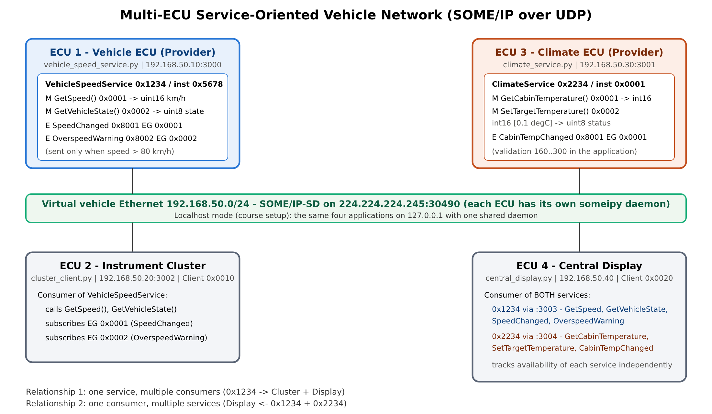

## 2. Service Specification

| Item | VehicleSpeedService | ClimateService |
|---|---|---|
| Provider ECU | Vehicle ECU (`vehicle_speed_service.py`) | Climate ECU (`climate_service.py`) |
| Service ID / Instance ID | **0x1234 / 0x5678** | **0x2234 / 0x0001** |
| Major version / transport | 1 / UDP | 1 / UDP |
| Provider endpoint | port 3000 | port 3001 |
| Method 0x0001 | `GetSpeed()`: empty → uint16 km/h *(Assignment 1)* | `GetCabinTemperature()`: empty → int16 (0.1 °C) |
| Method 0x0002 | `GetVehicleState()`: empty → uint8 (0 STOPPED, 1 MOVING) | `SetTargetTemperature()`: int16 (0.1 °C) → uint8 (0 ACCEPTED, 1 INVALID_TEMPERATURE) |
| Event 0x8001 | `SpeedChanged`: uint16 km/h, Event Group **0x0001** *(Assignment 1)* | `CabinTemperatureChanged`: int16 (0.1 °C), Event Group **0x0001** |
| Event 0x8002 | `OverspeedWarning`: uint16 km/h, Event Group **0x0002**, only if speed > 80 | - |

| Consumer ECU | Client ID | Client endpoint(s) | Uses |
|---|---|---|---|
| Instrument Cluster (`cluster_client.py`) | 0x0010 | :3002 | VehicleSpeedService: both methods, EG 0x0001 + 0x0002 |
| Central Display (`central_display.py`) | 0x0020 | :3003 (0x1234), :3004 (0x2234) | Both services: all methods and all event groups |

All payloads are big-endian someipy `SomeIpPayload` dataclasses (`Uint16`, `Uint8`, `Sint16`), defined once in the interface files and imported by provider and consumers alike.

## 3. Implementation (Tasks 11-15)

| File | Task | What it does |
|---|---|---|
| `src/vehicle_speed_interface.py` | 11.1, 11.2 | Assignment 1 IDs kept. Adds `GET_VEHICLE_STATE_METHOD_ID = 0x0002`, `OVERSPEED_WARNING_EVENT_ID = 0x8002`, `OVERSPEED_EVENTGROUP_ID = 0x0002`, `VehicleStatePayload(uint8)` and `build_vehicle_speed_service()` (2 methods, 2 event groups) |
| `src/vehicle_speed_service.py` | 11.3, 11.4 | `get_vehicle_state_handler`: request received → reads `current_speed_kmph` → `0 if speed == 0 else 1` → uint8 response. The speed simulation sends **SpeedChanged on every change**, then **OverspeedWarning only if `current_speed_kmph > 80`** |
| `src/cluster_client.py` | 12 | Discovers 0x1234; calls GetSpeed + GetVehicleState on discovery and every 8 s; subscribes to both event groups; prints the required messages (`SpeedChanged notification received`, `OVERSPEED WARNING`, `Vehicle State : STOPPED`) |
| `src/climate_interface.py` | 13 | ClimateService 0x2234/0x0001; method/event IDs; `CabinTemperaturePayload`, `TargetTemperaturePayload` (int16) and `SetTargetTemperatureStatusPayload` (uint8) |
| `src/climate_service.py` | 14 | Keeps cabin temperature (starts at 24.0 °C) and target (22.0 °C). `SetTargetTemperature` accepts **160..300 only** and leaves the target unchanged otherwise. Cabin temperature cycles 24.0 → 26.0 → 24.0 °C in 0.5 °C steps every 3 s, with `CabinTemperatureChanged` on every change |
| `src/central_display.py` | 15 | Two `ClientServiceInstance`s, one per service. Availability of each is tracked **in its own task**. Shows the CENTRAL VEHICLE DISPLAY panel; all values come from SOME/IP methods and events. Runs the Task 20 tests when ClimateService appears |
| `src/ecu_common.py` | - | Daemon connection (localhost or per-ECU daemon), task-safe `is_available()` / `call_method()` (see section 4.2), graceful stop on Ctrl+C/SIGTERM |

Speed profile (one step every 2 s): 0, 0, 20, 40, 50, 60, 70, **80, 90, 100, 90, 80**, 70, 50, 30, 10, 0, 0 (repeats). It passes the exact threshold test points from the specification:

| Speed | SpeedChanged | OverspeedWarning | Evidence (`logs/run/vehicle.log`) |
|---|---|---|---|
| 70 km/h | sent | not generated | `Speed = 70 km/h -> SpeedChanged sent, OverspeedWarning not generated` |
| 80 km/h | sent | **not generated** (80 is not > 80) | 6 occurrences in the run, never with a warning |
| 90 km/h | sent | **sent** | `Speed = 90 km/h -> SpeedChanged sent, OverspeedWarning sent` |
| 100 km/h | sent | sent | `Speed = 100 km/h -> SpeedChanged sent, OverspeedWarning sent` |

## 4. Test Environment

### 4.1 Two ways to run the same code

| | Localhost mode (Assignment 1 environment) | Virtual vehicle network mode |
|---|---|---|
| Network | 127.0.0.1 (loopback) | 4 Linux network namespaces on one virtual Ethernet bus, 192.168.50.10/.20/.30/.40 |
| someipy daemon | **one shared daemon** for all 4 applications | **one daemon per ECU**, as on real ECUs |
| Start | `someipyd`, then `python3 src/<ecu>.py` in 4 terminals | `sudo scripts/vehicle_network_setup.sh`, then `sudo scripts/ecu.sh vehicle\|cluster\|climate\|display` in 4 terminals |
| Behaviour | All functions work (5/5 validation PASS, events received) | All functions work |
| Visible in Wireshark | SD Offer/StopOffer and all method REQUEST/RESPONSE pairs. **No events and no Subscribe/SubscribeAck** | **Everything**: Offer, Subscribe, SubscribeAck, StopOffer, StopSubscribe, requests, responses, notifications |
| Capture | `captures/localhost-single-daemon.pcapng` (18 Offers, 2 StopOffers, 56 method messages, 0 notifications) | `captures/assignment2-multi-ecu.pcapng` (main capture) |

**Why the difference (verified in someipy's source).** When the provider and consumer are attached to the *same* daemon, someipy delivers events and subscriptions to the local applications internally over the daemon's Unix socket. The code path is labelled *"Handle internal subscriptions (UDS clients)"*. Those messages never reach the network, so Wireshark cannot see them. Giving each ECU its own daemon and IP address makes the communication identical to separate physical ECUs. That is why the virtual vehicle network was used for Tasks 16-22.

### 4.2 Problems found in someipy 2.1.2 and how they were handled

Running separate daemons exposed three defects in someipy 2.1.2 (the current PyPI release) and one usage pitfall. All were diagnosed from logs and the library source. The fixes are kept outside the library, in `scripts/someipyd_ecu.py` (a launcher for the standard daemon) and `src/ecu_common.py`.

| # | Symptom | Root cause | Fix |
|---|---|---|---|
| 1 | Provider daemon crashed on the first network Subscribe: `TypeError: unhashable type: 'Method'`. No SubscribeAck, no events | `someipy.service.Method` defines `__eq__` without `__hash__` | Add the same `__hash__` that already exists on someipy's master branch |
| 2 | Each SpeedChanged arrived **twice** at a consumer subscribed to EG 0x0001 and 0x0002 | The daemon sends every event to every subscriber of the service and ignores the subscriber's event group | Pass the original send function only the subscribers of the event group in the request |
| 3 | After a provider stopped, consumers showed it as AVAILABLE forever | A log line uses `subscription.eventgroup_id` (it should be `.eventgroup.id`). The AttributeError kills the daemon's service-TTL checker task | Provide the missing attribute so the TTL checker keeps running |
| 4 | Central Display reported ClimateService AVAILABLE before the Climate ECU had started | Replies to the daemon's FindService queries share one queue without a request ID, so two concurrent queries in one app can swap answers | Serialise each app's `is_available()` / `call_method()` with an asyncio lock (`ecu_common.py`) |

After these fixes, every requirement behaved as specified. Before the fixes, the duplicated events and the never-disappearing service were directly visible in the logs and the capture.

## 5. Demonstrations (Tasks 16-21)

All results below come from one automated run (`scripts/run_full_scenario.sh`). Its timeline (`logs/run/timeline.log`):

| Time | Step |
|---|---|
| 23:28:16 | Capture started; Instrument Cluster + Central Display started (consumers first) |
| 23:28:24 | Vehicle ECU started |
| 23:28:36 | Climate ECU started (Central Display runs the Task 20 tests) |
| 23:29:10 | **21.1** Climate ECU stopped with Ctrl+C (SIGTERM) |
| 23:29:28 | Climate ECU restarted |
| 23:29:48 | **21.2** Vehicle ECU hard failure: application **and its daemon** killed (power-loss case) |
| 23:30:06 | Vehicle ECU restarted |
| 23:30:36 | All ECUs stopped gracefully |

### 5.1 Task 16-17: four ECUs and independent Service Discovery

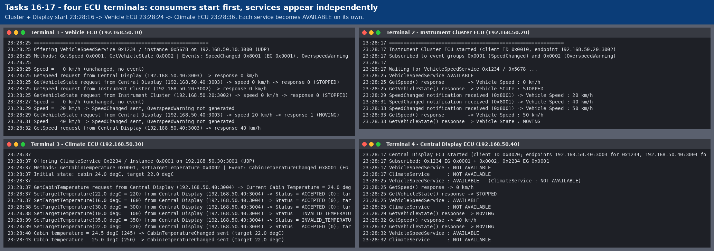

1. **17.1:** both consumers started and printed `VehicleSpeedService : NOT AVAILABLE` / `ClimateService : NOT AVAILABLE`. They had already registered their subscriptions with their daemons.
2. **17.2:** the Vehicle ECU's first OfferService (frame 6, 23:28:25.0) was followed within 1 ms by Subscribes from both consumers (frames 7-9, 13) and SubscribeAcks (frames 10-12, 14). Both consumers then called GetSpeed/GetVehicleState (frames 15-22). The Display showed `VehicleSpeedService : AVAILABLE (ClimateService : NOT AVAILABLE)`.
3. **17.3:** 12 s later the Climate ECU offered 0x2234 (frame 96). Only then did the Display report `ClimateService : AVAILABLE`.

**Understanding:** each service is announced by its own provider in its own OfferService entry (with its own Service ID, instance, TTL and endpoint), and each consumer looks up each service separately. The availability of 0x1234 therefore says nothing about 0x2234. For 12 s the system ran with one service available and the other not.

### 5.2 Task 18-19: multiple consumers, and one consumer of multiple services

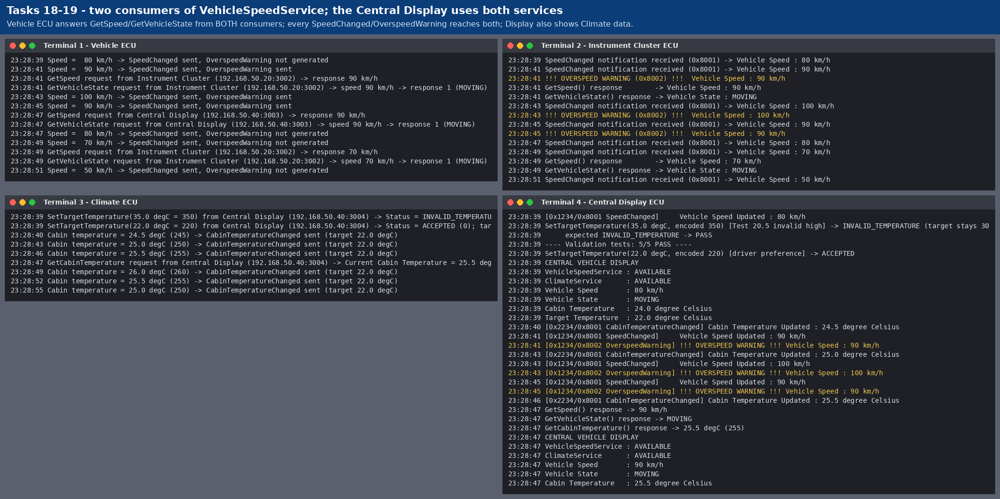

- **Methods from two consumers (18):** the Vehicle ECU served `GetSpeed`/`GetVehicleState` to **both** consumers, logged as `... request from Instrument Cluster (192.168.50.20:3002)` and `... from Central Display (192.168.50.40:3003)`. In the capture: GetSpeed 15 requests from Client 0x0010 + 10 from 0x0020; GetVehicleState 17 + 16; every request has a matching response.
- **Events to two consumers (18):** every SpeedChanged and OverspeedWarning is transmitted **once to each subscriber**: 47 SpeedChanged to .20 and 47 to .40, 9 OverspeedWarning to each. Example: frames 33/34 carry the same 20 km/h notification 75 µs apart to the two endpoints.
- **One consumer, two services (19):** the Central Display received data from 192.168.50.10 (0x1234) **and** 192.168.50.30 (0x2234) through two independent client instances. Its panel combined speed, state, cabin and target temperature, all obtained through SOME/IP (nothing duplicated locally), for example `Vehicle Speed : 80 km/h | Vehicle State : MOVING | Cabin Temperature : 24.0 degree Celsius | Target Temperature : 22.0 degree Celsius`.

### 5.3 Task 20: SetTargetTemperature validation

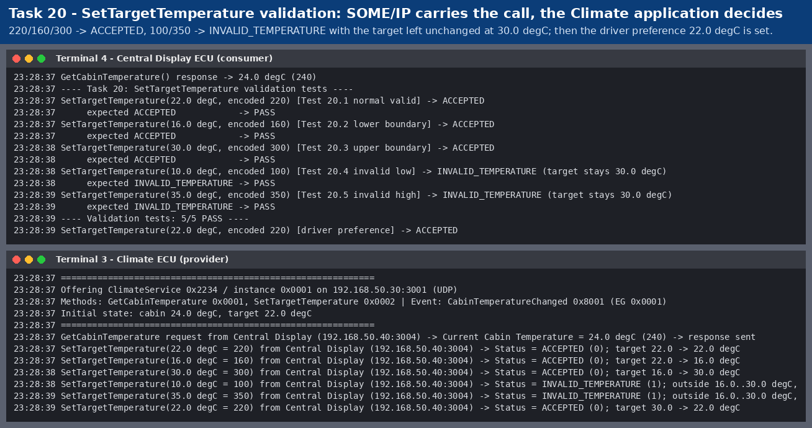

| Test | Request (°C / encoded) | Response | Climate ECU target after the call | Wireshark frames | Result |
|---|---|---|---|---|---|
| 20.1 normal | 22.0 / 220 (`00 dc`) | ACCEPTED (`00`) | 22.0 | 112 / 113 | PASS |
| 20.2 lower boundary | 16.0 / 160 (`00 a0`) | ACCEPTED | 16.0 | 115 / 116 | PASS |
| 20.3 upper boundary | 30.0 / 300 (`01 2c`) | ACCEPTED | 30.0 | 117 / 118 | PASS |
| 20.4 invalid low | 10.0 / 100 (`00 64`) | INVALID_TEMPERATURE (`01`) | **30.0 (unchanged)** | 119 / 120 | PASS |
| 20.5 invalid high | 35.0 / 350 (`01 5e`) | INVALID_TEMPERATURE (`01`) | **30.0 (unchanged)** | 135 / 136 | PASS |

The Display then set the driver preference back to 22.0 °C (frames 137/138). In every response, including the invalid ones, the **SOME/IP Return Code is 0x00 (E_OK)**: the transport delivered request and response correctly. The decision ACCEPTED or INVALID_TEMPERATURE is made by the **Climate application** (`TARGET_TEMPERATURE_MIN <= value <= TARGET_TEMPERATURE_MAX`) and carried as payload. SOME/IP only transports it.

### 5.4 Task 21.1: Climate ECU stopped and restarted

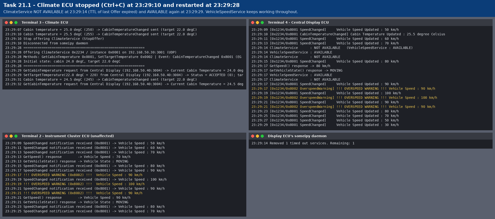

| Observation | Time | Evidence |
|---|---|---|
| Climate app stopped; sends **StopOffer** (Offer entry with TTL 0) | 23:29:10.75 | Climate log `Stop offering ClimateService (StopOffer)`; frame 402 |
| Display's daemon removes 0x2234 | 23:29:14 | daemon log `Removed 1 timed out services` (5 s after the last Offer, frame 394 at 23:29:09.0) |
| Central Display | 23:29:14 | `ClimateService : NOT AVAILABLE (VehicleSpeedService : AVAILABLE)` |
| VehicleSpeedService during the outage | 23:29:10-28 | 30 vehicle-service exchanges in the two consumers: SpeedChanged, OverspeedWarning (90/100 km/h), GetSpeed and GetVehicleState all continued |
| Climate restarted; Offer again | 23:29:28.8 | frame 524; Subscribe/Ack for EG 0x0001 follow immediately |
| Display | 23:29:29 | `ClimateService : AVAILABLE`, `GetCabinTemperature() -> 24.0 degC`, `SetTargetTemperature(22.0) -> ACCEPTED` (frames 544/545) |
| Events after recovery | 23:29:31 onward | `CabinTemperatureChanged ... 24.5 degree Celsius` received again (re-subscription is automatic: the consumer daemon re-sends the Subscribe on every Offer) |

**Observed detail:** the StopOffer was visible on the wire immediately. However, someipy 2.1.2's consumer daemon marked the service unavailable only when the TTL of the last regular Offer expired, about 4 s later. Real AUTOSAR stacks usually act on the StopOffer at once.

### 5.5 Task 21.2: Vehicle ECU hard failure and restart

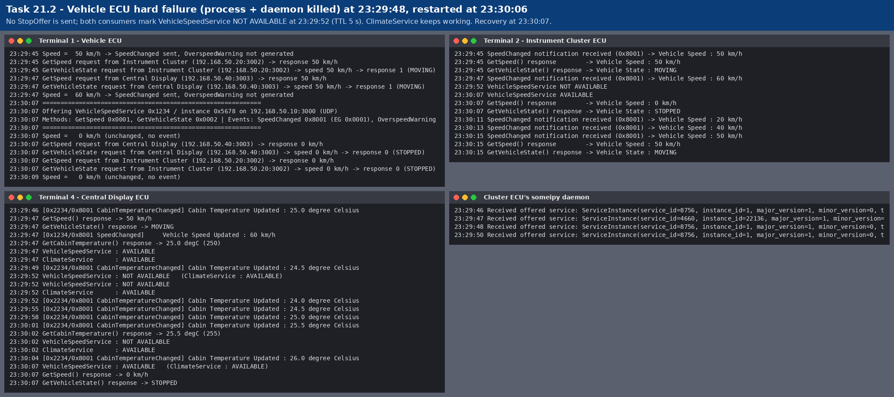

| Observation | Time | Evidence |
|---|---|---|
| Vehicle ECU process and daemon killed (no clean shutdown) | 23:29:48 | timeline; **no StopOffer for 0x1234** in the capture until the final shutdown at 23:30:36 |
| Last Offer 0x1234 | 23:29:47.0 | frame 690 |
| Both consumer daemons remove 0x1234 | 23:29:52.1 | `Removed 1 timed out services` = TTL 5 s after the last Offer |
| Instrument Cluster / Central Display | 23:29:52 | `VehicleSpeedService NOT AVAILABLE` / `VehicleSpeedService : NOT AVAILABLE (ClimateService : AVAILABLE)` |
| ClimateService during the outage | 23:29:48-30:06 | `CabinTemperatureChanged` every 3 s and `GetCabinTemperature() -> 25.5 degC` kept working on the Display |
| Vehicle ECU restarted | 23:30:06 | new daemon + app; Offer frame 747 at 23:30:07.1 |
| Consumers recovered | 23:30:07 | `VehicleSpeedService AVAILABLE`, `GetSpeed -> 0 km/h`, `GetVehicleState -> STOPPED`; SpeedChanged from 23:30:11, OverspeedWarning at 90/100 km/h again |

**Understanding:** VehicleSpeedService and ClimateService are provided independently, by different ECUs, each with its own Offer, TTL and endpoint. Losing one provider removed only that service. The other service, its methods and its events continued without interruption in both experiments. Graceful stop (StopOffer) and hard failure (Offers simply stop) were both detected through the Offer TTL of 5 s, and recovery took about 1 s after restart.

## 6. Wireshark Analysis (Task 22)

Capture point: the virtual bus `br0`. Settings: *Analyze → Decode As* UDP ports 30490 and 3000-3004 → SOME/IP. Name tables from `wireshark_profile/` show service, method and event names.

### 6.1 Traffic overview (`captures/assignment2-multi-ecu.pcapng`)

| Message | VehicleSpeedService 0x1234 | ClimateService 0x2234 |
|---|---|---|
| SD OfferService (TTL 5, every 2 s) | 57 | 51 |
| SD StopOfferService (TTL 0) | 1 (final shutdown only) | 2 (21.1 + final) |
| SD SubscribeEventgroup / SubscribeAck | 228 / 228 (EG 0x0001 + 0x0002, 2 consumers) | 51 / 51 (EG 0x0001) |
| SD StopSubscribeEventgroup | 4 | 1 |
| Method 0x0001 REQUEST / RESPONSE | 25 / 25 (GetSpeed) | 9 / 9 (GetCabinTemperature) |
| Method 0x0002 REQUEST / RESPONSE | 33 / 33 (GetVehicleState) | 7 / 7 (SetTargetTemperature) |
| Event 0x8001 NOTIFICATION | 94 (SpeedChanged, 47 × 2 consumers) | 33 (CabinTemperatureChanged) |
| Event 0x8002 NOTIFICATION | 18 (OverspeedWarning, 9 × 2) | - |

### 6.2 Service Discovery (22.3)

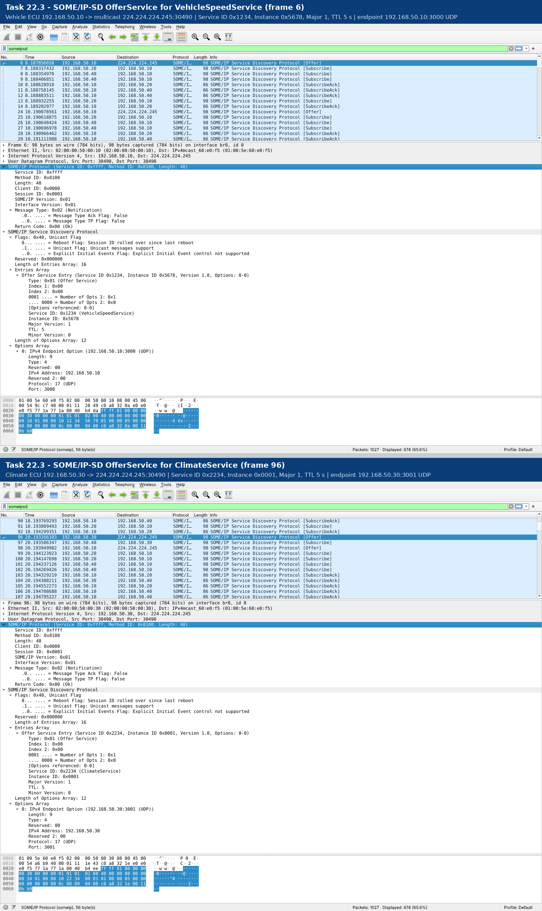

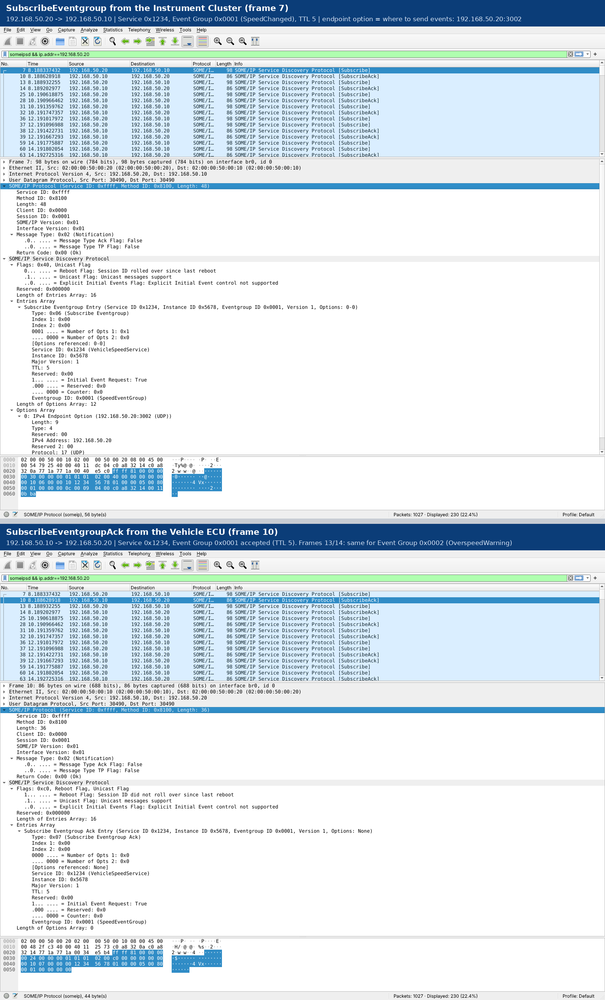

SD messages use SOME/IP header Service ID **0xFFFF**, Method ID **0x8100**, Message Type NOTIFICATION, on UDP port 30490.

- **OfferService** entries are multicast to 224.224.224.245: frame 6 for **0x1234** (endpoint 192.168.50.10:3000) and frame 96 for **0x2234** (endpoint 192.168.50.30:3001).
- **SubscribeEventgroup** entries are sent unicast to the provider. They carry the event group ID and an IPv4 Endpoint Option telling the provider where to send events (for example 192.168.50.20:3002).
- **SubscribeEventgroupAck** confirms each subscription.

### 6.3 Methods (22.4, 22.6)

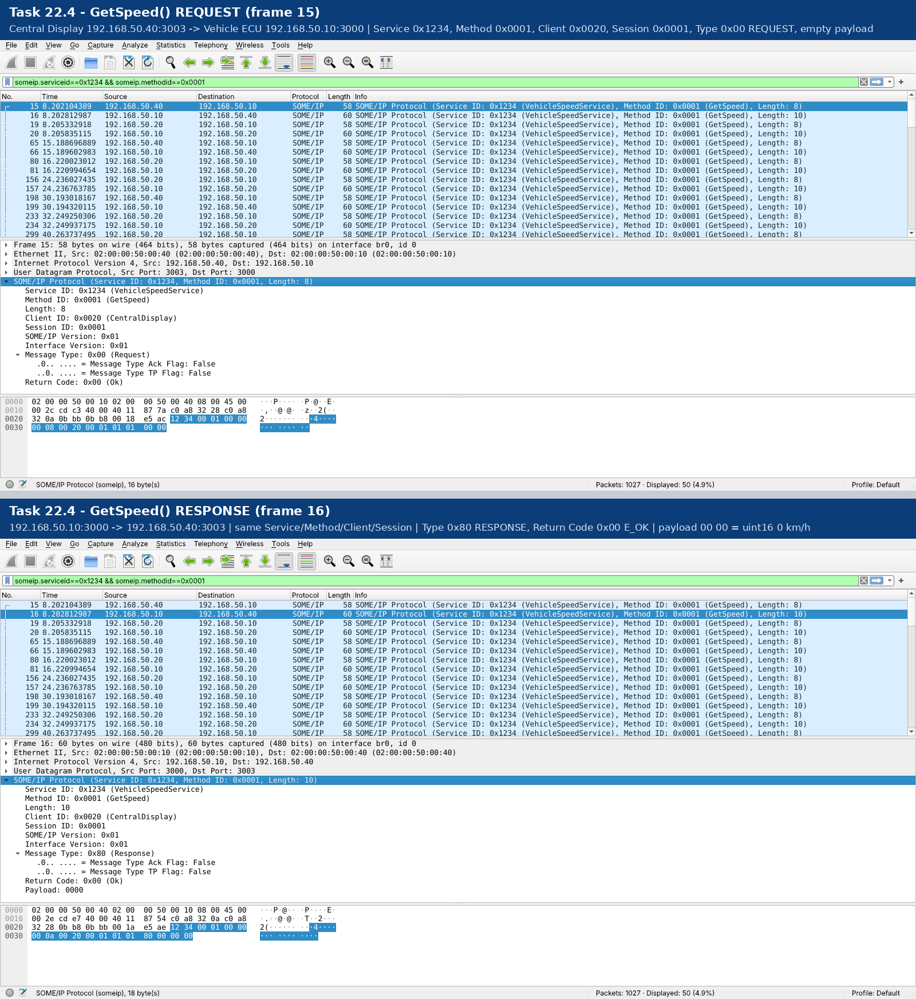

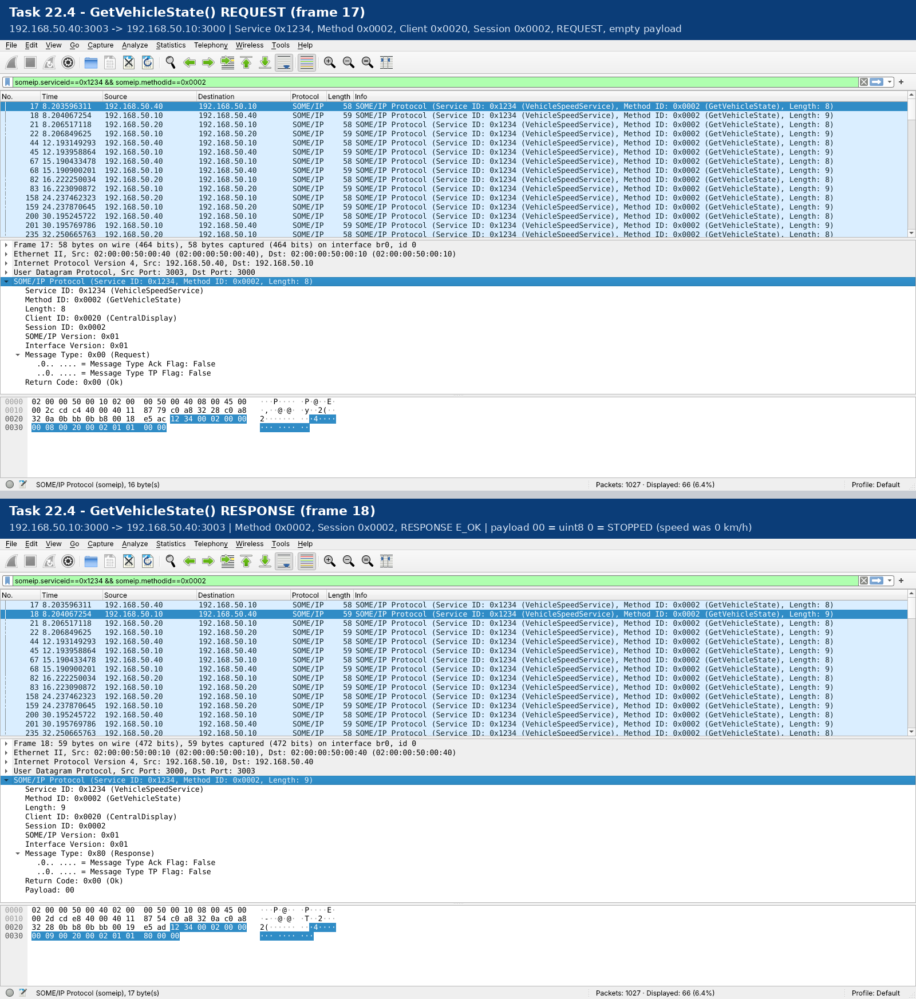

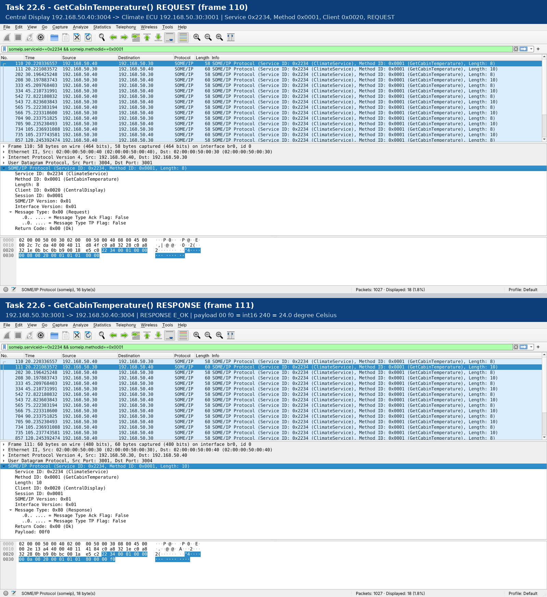

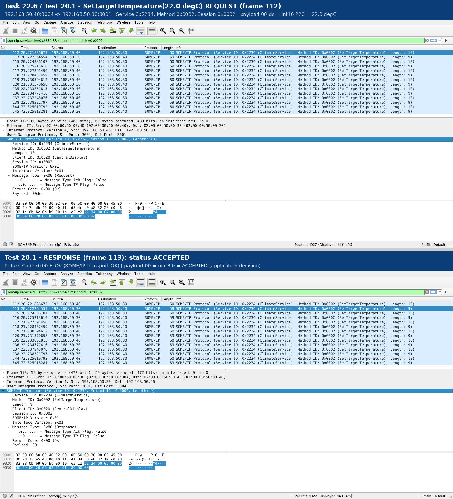

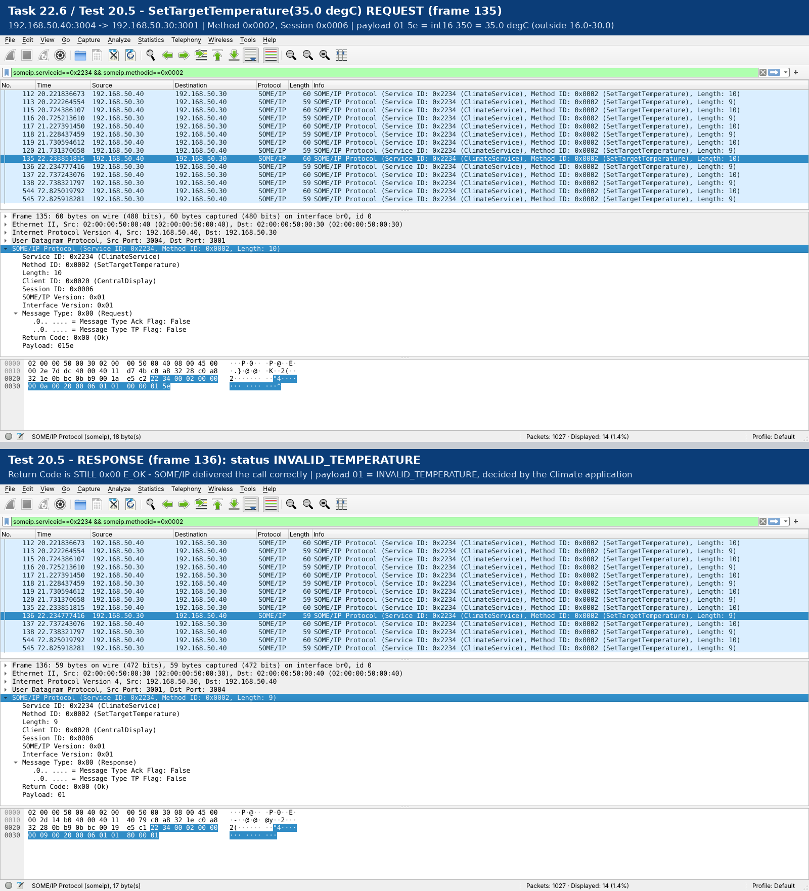

A REQUEST (type 0x00) and its RESPONSE (type 0x80) share Service ID, Method ID, Client ID and Session ID. This is how the consumer matches them; the Session ID increments with each call (0x0001, 0x0002 ...).

### 6.4 Events (22.5, 22.7)

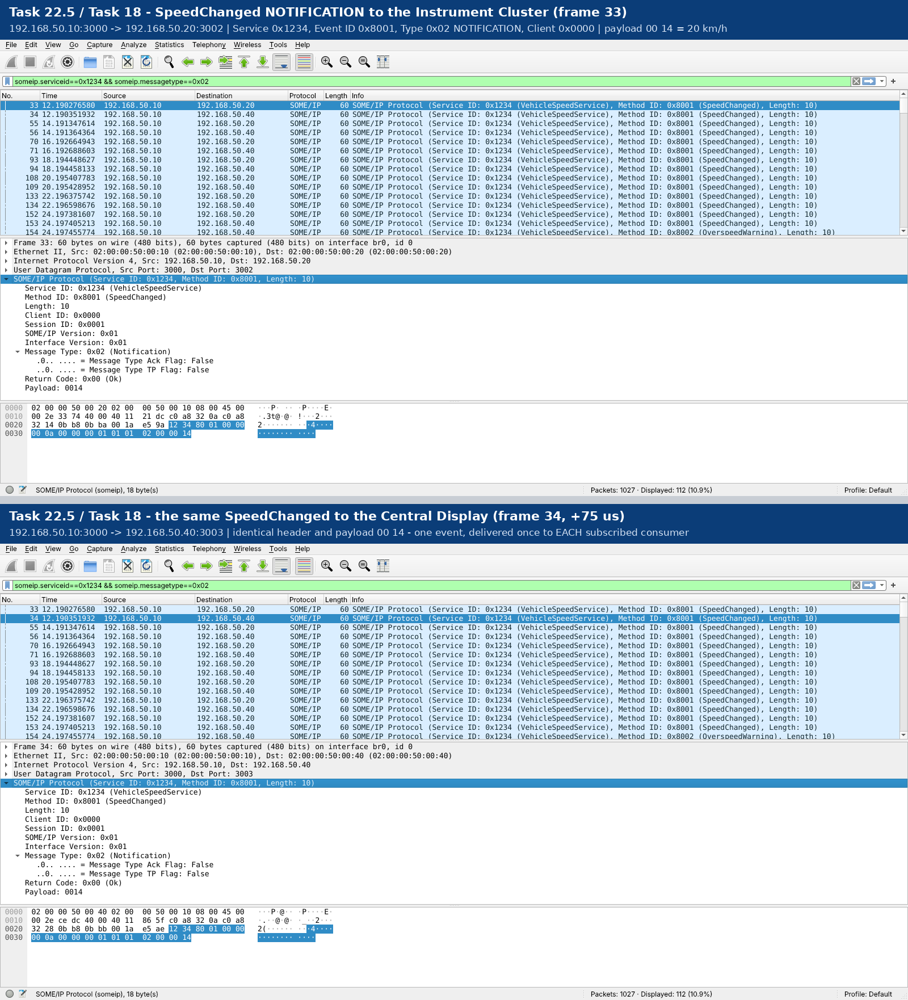

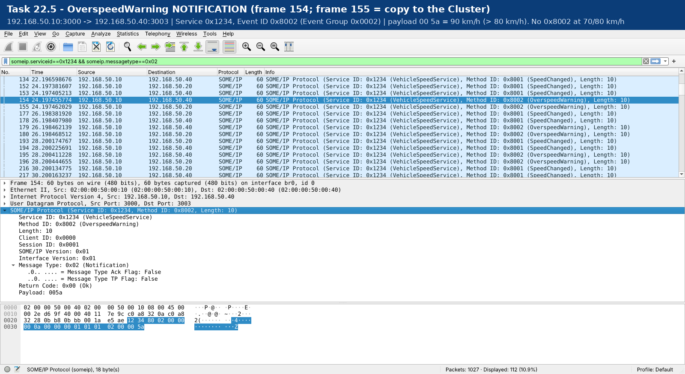

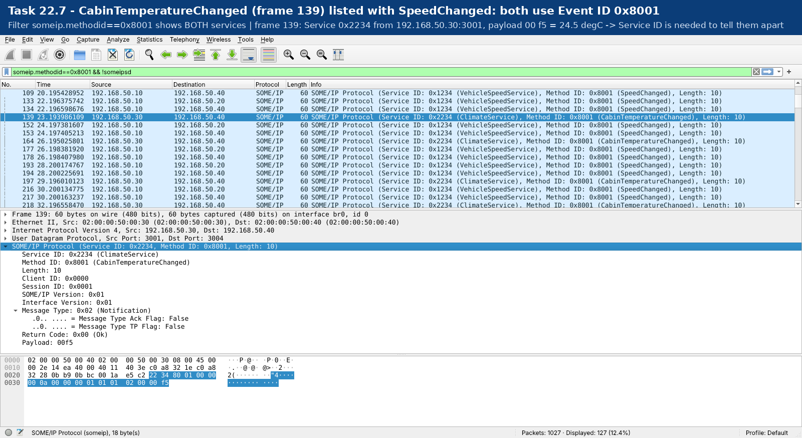

Notifications have Message Type 0x02 and Client ID 0x0000 (they are not answers to a particular client).

The filter `someip.methodid == 0x8001` returns **both** SpeedChanged (0x1234, from .10:3000) and CabinTemperatureChanged (0x2234, from .30:3001). **Event ID alone does not identify the event**: the pair (Service ID, Event ID) does. The correct filters are `someip.serviceid==0x1234 && someip.methodid==0x8001` and `someip.serviceid==0x2234 && someip.methodid==0x8001`.

*Observed:* someipy 2.1.2 sends all notifications with Session ID 0x0001 (145 notifications, all 0x0001), whereas method calls increment it.

### 6.5 Representative packets (22.8)

| Frame | Message | Src IP:Port → Dst IP:Port | Service | Method / Event | Client | Session | Proto / Iface ver. | Type | Return | Payload |
|---|---|---|---|---|---|---|---|---|---|---|
| 6 | SD Offer 0x1234 | 192.168.50.10:30490 → 224.224.224.245:30490 | 0xFFFF | 0x8100 | 0x0000 | 0x0001 | 0x01 / 0x01 | 0x02 | 0x00 | Offer entry 0x1234/0x5678 v1 TTL 5 + endpoint .10:3000 |
| 15 | GetSpeed request | 192.168.50.40:3003 → 192.168.50.10:3000 | 0x1234 | 0x0001 | 0x0020 | 0x0001 | 0x01 / 0x01 | 0x00 REQUEST | 0x00 | (empty) |
| 16 | GetSpeed response | .10:3000 → .40:3003 | 0x1234 | 0x0001 | 0x0020 | 0x0001 | 0x01 / 0x01 | 0x80 RESPONSE | 0x00 | `00 00` = 0 km/h |
| 18 | GetVehicleState response | .10:3000 → .40:3003 | 0x1234 | 0x0002 | 0x0020 | 0x0002 | 0x01 / 0x01 | 0x80 | 0x00 | `00` = STOPPED |
| 33 | SpeedChanged | .10:3000 → .20:3002 | 0x1234 | **0x8001** | 0x0000 | 0x0001 | 0x01 / 0x01 | 0x02 NOTIFICATION | 0x00 | `00 14` = 20 km/h |
| 154 | OverspeedWarning | .10:3000 → .40:3003 | 0x1234 | **0x8002** | 0x0000 | 0x0001 | 0x01 / 0x01 | 0x02 | 0x00 | `00 5a` = 90 km/h |
| 111 | GetCabinTemperature response | .30:3001 → .40:3004 | 0x2234 | 0x0001 | 0x0020 | 0x0001 | 0x01 / 0x01 | 0x80 | 0x00 | `00 f0` = 24.0 °C |
| 112 / 113 | SetTargetTemperature | .40:3004 ⇄ .30:3001 | 0x2234 | 0x0002 | 0x0020 | 0x0002 | 0x01 / 0x01 | 0x00 / 0x80 | 0x00 | `00 dc` (22.0) / `00` ACCEPTED |
| 135 / 136 | SetTargetTemperature | .40:3004 ⇄ .30:3001 | 0x2234 | 0x0002 | 0x0020 | 0x0006 | 0x01 / 0x01 | 0x00 / 0x80 | 0x00 | `01 5e` (35.0) / `01` INVALID |
| 139 | CabinTemperatureChanged | .30:3001 → .40:3004 | **0x2234** | **0x8001** | 0x0000 | 0x0001 | 0x01 / 0x01 | 0x02 | 0x00 | `00 f5` = 24.5 °C |

All 293 SOME/IP (non-SD) messages carry protocol version 0x01, interface version 0x01 (= major version 1) and return code 0x00.

### 6.6 Failure experiments on the wire

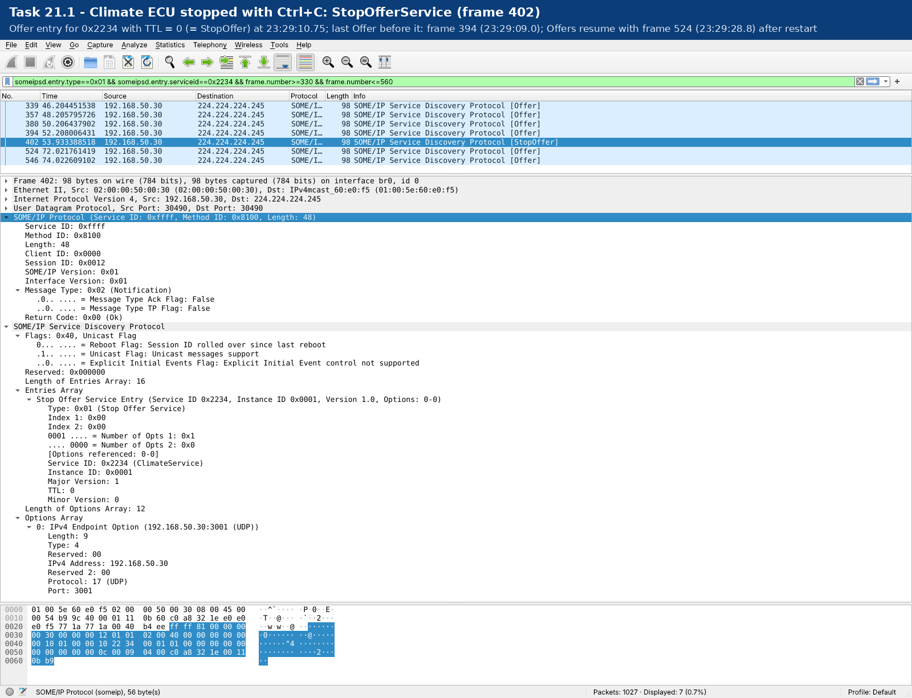

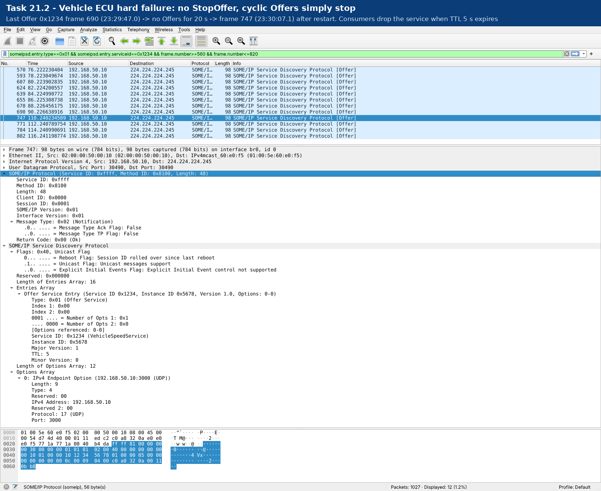

## 7. Service Design Explanation (Task 23)

| Element | Type | Who initiates / publishes | Why this communication pattern |
|---|---|---|---|
| **GetSpeed()** | Method | A **consumer** (Cluster or Display) requests; the **Vehicle ECU** responds | The consumer needs the speed *at a moment of its choosing*: at start-up, after discovery, or for a periodic refresh. It expects exactly one answer, so request-response fits. It also gives a newly started consumer the current value without waiting for the next change |
| **GetVehicleState()** | Method | Consumer requests; Vehicle ECU responds | The consumer asks for a derived state (STOPPED/MOVING, uint8) when it needs it, e.g. at start-up or when SpeedChanged reports 0 km/h. The answer is computed by the owner of the speed data, so every consumer applies the same rule and gets a direct, confirmed answer |
| **SpeedChanged** | Event (EG 0x0001) | The **Vehicle ECU** detects the change in its simulation and publishes it | Speed changes at the provider's pace. Pushing each change to all subscribers gives every display the new value immediately, without any of them polling. One notification is sent per subscriber, whatever the number of consumers |
| **OverspeedWarning** | Event (EG 0x0002) | **Vehicle ECU** detects `speed > 80` and publishes | The Vehicle ECU owns the speed and the threshold, so the rule is applied once, consistently, and immediately. Consumers must not have to poll for a warning: polling adds delay of up to one poll period and constant traffic for a rare situation. A separate event group lets a consumer subscribe to warnings without (or in addition to) all speed updates |
| **GetCabinTemperature()** | Method | Consumer (Central Display) requests; Climate ECU responds | The Display needs the current temperature on demand: when it starts, when ClimateService (re)appears, and for its periodic refresh. It cannot wait up to 3 s for the next change event |
| **SetTargetTemperature()** | Method | **Consumer initiates** (driver input on the Central Display); Climate ECU executes | It is a command from the user side, so the consumer starts it. A **request payload** is needed to carry the requested value (int16, 0.1 °C). A **response status** is needed because the provider may refuse the value: the caller must know whether it was ACCEPTED or INVALID_TEMPERATURE in order to show the right result to the driver |
| **CabinTemperatureChanged** | Event (EG 0x0001 of 0x2234) | **Climate ECU** measures/simulates the cabin temperature and publishes changes | Changes happen at the sensor's pace. Subscribed displays receive every new value automatically, so they stay current without polling |

**Rule of thumb applied:** use a **method** when the consumer decides *when* it needs data or wants an action performed and needs an answer. Use an **event** when the provider detects a change that several parties should learn about as soon as it happens.

## 8. Viva Questions - Answers

| # | Question | Answer |
|---|---|---|
| 1 | How many logical ECUs? | Four: Vehicle, Instrument Cluster, Climate, Central Display |
| 2 | Service Providers? | Vehicle ECU (VehicleSpeedService) and Climate ECU (ClimateService) |
| 3 | Service Consumers? | Instrument Cluster and Central Display |
| 4 | Can one ECU be provider and consumer? | Yes. SOME/IP roles are per service, so an ECU can offer one service and consume another (e.g. a gateway). Not used here, but nothing prevents it |
| 5 | Purpose of VehicleSpeedService? | To provide vehicle speed, vehicle state and overspeed warnings to any ECU that needs them |
| 6 | Its Service ID? | 0x1234 |
| 7 | Its Instance ID? | 0x5678 |
| 8 | Its methods? | GetSpeed() 0x0001, GetVehicleState() 0x0002 |
| 9 | Its events? | SpeedChanged 0x8001 (EG 0x0001), OverspeedWarning 0x8002 (EG 0x0002) |
| 10 | Purpose of GetVehicleState()? | Returns whether the vehicle is STOPPED (0) or MOVING (1) |
| 11 | Why is it a method? | The consumer asks when it needs the state and expects one direct answer (request-response) |
| 12 | How is the state calculated? | In the Vehicle ECU: speed == 0 → STOPPED, speed > 0 → MOVING |
| 13 | Method ID of GetVehicleState()? | 0x0002 |
| 14 | Purpose of OverspeedWarning? | Alerts consumers immediately when the vehicle is too fast |
| 15 | What generates it? | `current_speed_kmph > 80`, checked after each speed update (after SpeedChanged) |
| 16 | Why no warning at exactly 80 km/h? | The condition is strictly *greater than* 80. 80 is the limit itself, not above it (verified: 6 SpeedChanged at 80 km/h, no warning) |
| 17 | Event ID of OverspeedWarning? | 0x8002 |
| 18 | Its Event Group ID? | 0x0002 |
| 19 | Purpose of ClimateService? | To provide cabin temperature and let other ECUs set the target temperature |
| 20 | Service ID of ClimateService? | 0x2234 (Instance 0x0001) |
| 21 | What does GetCabinTemperature() return? | The current cabin temperature as int16 in tenths of °C (e.g. 240 = 24.0 °C) |
| 22 | Why tenths of a degree? | It sends decimal values as integers: exact, compact (2 bytes), endian-safe, no floating-point encoding |
| 23 | What does SetTargetTemperature() do? | Requests a new target temperature (int16, 0.1 °C) and returns a status |
| 24 | Valid range? | 16.0-30.0 °C = 160-300 (boundaries included) |
| 25 | Invalid temperature requested? | Response INVALID_TEMPERATURE (1); the target stays unchanged (tests 20.4 and 20.5 left it at 30.0 °C) |
| 26 | Who validates the range? | The Climate **application**. SOME/IP only transports the request and response (Return Code stayed E_OK) |
| 27 | What is CabinTemperatureChanged? | Event 0x8001 of ClimateService carrying the new cabin temperature (int16) |
| 28 | Why an event? | The Climate ECU detects the change, and all subscribers should get it automatically without polling |
| 29 | Which ECU consumes both services? | The Central Display |
| 30 | Service consumed by Cluster and Display? | VehicleSpeedService (0x1234) |
| 31 | Can two services use the same Method ID? | Yes: 0x0001/0x0002 exist in both. IDs are unique only within a service |
| 32 | Same Event ID? | Yes: 0x8001 is SpeedChanged in 0x1234 and CabinTemperatureChanged in 0x2234 |
| 33 | Why consider Service ID too? | A message is identified by (Service ID, Method/Event ID). Without the Service ID, 0x8001 is ambiguous (section 6.4) |
| 34 | What happens when the Climate ECU stops? | It sends StopOffer; consumers mark ClimateService NOT AVAILABLE (after about 4 s with someipy 2.1.2); its methods and events stop |
| 35 | Should VehicleSpeedService stop then? | No, and it did not: methods and events continued throughout (section 5.4) |
| 36 | What happens when the Vehicle ECU stops? | Offers stop (no StopOffer on a hard failure); consumers mark it NOT AVAILABLE when the TTL of 5 s expires; it recovers about 1 s after restart |
| 37 | Should ClimateService stop then? | No, and it did not (section 5.5) |
| 38 | Role of Service Discovery? | Providers announce services (Offer/StopOffer with TTL and endpoint); consumers find them and subscribe to event groups; TTLs detect lost providers. No IP or port is hard-coded in the consumers |
| 39 | How to distinguish the services in Wireshark? | By SOME/IP Service ID (0x1234 vs 0x2234); also by provider IP/port (.10:3000 vs .30:3001) and by SD entries |
| 40 | Method vs event? | A method is consumer-initiated request-response. An event is a provider-initiated notification to all subscribers, with no response |
| 41 | What is an Event Group? | A set of events that is subscribed to as a unit through Service Discovery |
| 42 | Why subscribe to an Event Group? | So the provider knows *which* consumer endpoint wants *which* events. Events are sent only to subscribers, and consumers receive only what they asked for |
| 43 | What is in a SOME/IP payload? | The serialised application data after the 16-byte header (here big-endian uint16/uint8/int16), e.g. `00 5a` = 90 km/h |
| 44 | Role of the someipy daemon? | It handles all SOME/IP networking for the applications on its ECU: SD (offer, find, subscribe, TTL), UDP endpoints, sending and receiving messages. Applications talk to it over a Unix socket |
| 45 | What does the Central Display demonstrate? | Service-oriented architecture: one application combines independent services from different providers, discovers them independently, and keeps working when one provider fails |

## 9. Conclusion

The project shows that a vehicle can be built as a set of independently offered and consumed SOME/IP services:

- Methods were chosen for on-demand reads and commands that need an answer. Events were chosen for changes detected by the owner of the data.
- Service Discovery lets consumers find each service independently and notice when a provider disappears.
- The two failure experiments confirmed that a fault in one provider does not affect unrelated services.
- Running each ECU with its own daemon made every protocol element observable in Wireshark. Along the way it exposed three real defects in someipy 2.1.2, which were diagnosed and worked around without changing the library.

## Appendix - How to Run

```bash
pip install someipy==2.1.2           # + sudo apt install wireshark
# --- localhost mode (Assignment 1 environment): 5 terminals
python3 scripts/someipyd_ecu.py --config config/someipyd.json   # daemon
cd src && python3 vehicle_speed_service.py   |  python3 cluster_client.py
          python3 climate_service.py         |  python3 central_display.py
# --- virtual vehicle network mode (recommended for Wireshark)
sudo scripts/vehicle_network_setup.sh
sudo ip netns exec vbus wireshark -i br0 &          # capture the vehicle bus
sudo scripts/ecu.sh cluster  |  sudo scripts/ecu.sh display  |  sudo scripts/ecu.sh vehicle  |  sudo scripts/ecu.sh climate
sudo scripts/vehicle_network_teardown.sh
# --- fully automated Tasks 16-22 with capture
sudo scripts/run_full_scenario.sh
```
